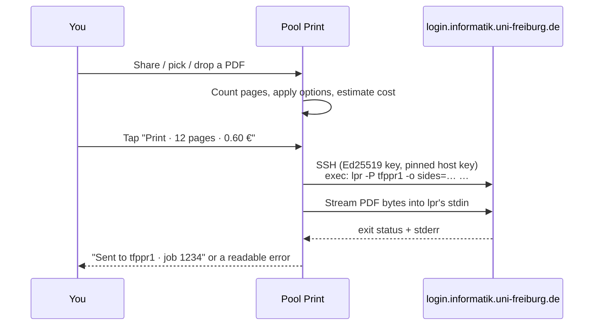

# Pool Print

Print PDFs on the **Uni Freiburg TF computer-pool printers** from your Android phone or Mac in a few
taps, without opening a terminal.

> **Status: in development.** Milestone 1 (onboarding, test connection, share/pick a PDF, print with
> printer and copies) is implemented and unit-tested, but not yet checked against the real pool server.
> The other features below are planned; see [docs/roadmap.md](docs/roadmap.md) for progress.

Pool Print wraps the pool's official SSH printing procedure:

```bash
cat file.pdf | ssh <POOL_USERNAME>@login.informatik.uni-freiburg.de "lpr -P tfppr1"
```

and adds a friendly UI, full control over the printing options, and a cost estimate before you print.

- 📲 **Share to print:** share a PDF from any Android app, or drop it onto the Mac window.
- 🔑 **Key-only login:** the app generates an SSH key. Your pool password is never asked for or stored.
- 🖨️ **All the options:** printer, copies, page ranges, duplex, pages per sheet, orientation, fit to page,
  paper size, plus printer-specific options read from the server.
- 💶 **Know the cost up front:** `Print · 12 pages · 0.60 €` (5 ct b/w, 10 ct colour, from your 6 € monthly budget).
- 🚫 **No server, no cloud, no tracking:** your device talks only to the pool login server.

## Printers

| Name | Type | Model |
|---|---|---|
| `tfppr1` | b/w | Ricoh MP 3554 |
| `tfppr2` | colour | HP Color LaserJet Enterprise M553 |
| `tfppr3` | b/w | HP LaserJet Enterprise MFP M528 |
| `tfppr4` | colour | HP Color LaserJet Enterprise M653 |

## How it works



1. The PDF never gets copied to your pool home directory. It's streamed straight into `lpr`.
2. The remote command is built only from validated values (enums, numbers, known printer and option
   names), and every argument is shell-quoted. Filenames never go into the command.
3. On the first connection, the server's host key fingerprint is shown and pinned. If it ever changes,
   the app refuses to connect and warns you.
4. Optionally (milestone 3), the app runs `lpstat -p` and `lpoptions -p <printer> -l` to discover
   printer-specific options. If that fails, it uses the built-in printer list and standard options.

More detail: [docs/architecture.md](docs/architecture.md) · [docs/security.md](docs/security.md) ·
[docs/print-options.md](docs/print-options.md).

## Setup: key onboarding

You need a TF pool account and a way to log in to it **once** to install the key: a pool computer, or
`ssh` with your password from a laptop.

1. Open Pool Print and enter your pool username.
2. The app generates an **Ed25519 key pair** and shows the public key. Tap **Copy** (or Share it to yourself).
3. Log in to your pool account and add the key:
   ```bash
   mkdir -p ~/.ssh && chmod 700 ~/.ssh
   echo 'ssh-ed25519 AAAA… pool-print@your-device' >> ~/.ssh/authorized_keys
   chmod 600 ~/.ssh/authorized_keys
   ```
4. Back in the app, check the server fingerprint and accept it. To compare, on a machine that already
   trusts the server, run:
   ```bash
   ssh-keygen -lF login.informatik.uni-freiburg.de
   ```
5. Tap **Test connection**. It runs `echo ok` on the server. ✓ means you're ready to print.

> **Off campus?** The login server is only reachable from the university network. Connect to the
> university VPN first, otherwise you'll get "Can't reach the pool server".

After onboarding, the app never asks for a password or passphrase again.

Where the private key is kept:
- **Android:** encrypted with a key held in the Android Keystore, and excluded from backups.
- **macOS:** in the login Keychain (item "Pool Print"). Unsigned builds may ask once after an update to
  allow Keychain access: choose **Always Allow**.

To revoke access, delete the key's line from `~/.ssh/authorized_keys` on the pool account.

## Building

Requirements: a JDK (the Gradle daemon is pinned to JDK 21, which the toolchain resolver can download); the Android SDK for the
Android app; macOS for building the `.dmg`.

### Android

```bash
./gradlew :androidApp:assembleDebug
```

The APK ends up in `androidApp/build/outputs/apk/debug/`. To install it on a connected device or emulator:

```bash
./gradlew :androidApp:installDebug
```

### Desktop (macOS)

Run:

```bash
./gradlew :desktopApp:run
```

Run with hot reload:

```bash
./gradlew :desktopApp:hotRun --auto
```

Build the `.dmg` installer:

```bash
./gradlew :desktopApp:packageDmg
```

The output goes to `desktopApp/build/compose/binaries/main/dmg/`. The app is unsigned, so on first launch
macOS will ask you to confirm opening it (right-click → Open). On the Mac you can drag a PDF onto the
window, use Finder's Open With → Pool Print, or press ⌘O; ⌘P prints from the print sheet.

### Tests

```bash
./gradlew :shared:jvmTest
```

```bash
./gradlew :shared:testAndroidHostTest
```

The tests use a fake SSH client and an in-process SSH server on loopback; they never contact the real pool
server. One extra test touches the macOS login keychain and only runs with `POOLPRINT_KEYCHAIN_TEST=1`.

## Project structure

```
shared/        all app logic and Compose UI (Kotlin Multiplatform)
  commonMain     models, validation, command builder, cost estimator, parsers, UI
  jvmCommonMain  SSH client (sshj), Ed25519 key generation (shared by Android and desktop)
  androidMain    Android Keystore, PDF page count, intents
  jvmMain        macOS Keychain, PDF page count, file handling
androidApp/    thin Android shell (manifest, MainActivity, share target)
desktopApp/    thin Compose Desktop shell (window, macOS packaging)
docs/          design documentation
```

## Documentation

| Document | Contents |
|---|---|
| [Project Overview](docs/Project%20Overview.md) | Product description, goals, constraints, environment facts |
| [Architecture](docs/architecture.md) | Modules, source sets, interfaces, data flow, platform layer |
| [Print options](docs/print-options.md) | CUPS option mapping, validation, discovery parsing, cost formula |
| [Security](docs/security.md) | Threat model, key storage, host-key pinning, safe command construction |
| [UI / UX](docs/ux.md) | Screens, main flow, error messages |
| [Roadmap](docs/roadmap.md) | Milestones, acceptance criteria, manual test checklists |
| [Decisions](docs/decisions.md) | Decision log and open questions |
| [Development guide](docs/development.md) | Contribution rules, testing strategy, milestone reports |

## Privacy

Pool Print has no analytics, telemetry or crash reporting, and it only talks to
`login.informatik.uni-freiburg.de`. Your SSH key stays on your device.

## Disclaimer

This is an unofficial student project. It isn't affiliated with the University of Freiburg, the TF
pool administration or the Fachschaft. The printing procedure it uses is the one described at
<https://fachschaft.tf/en/service/pool_printing/>.
