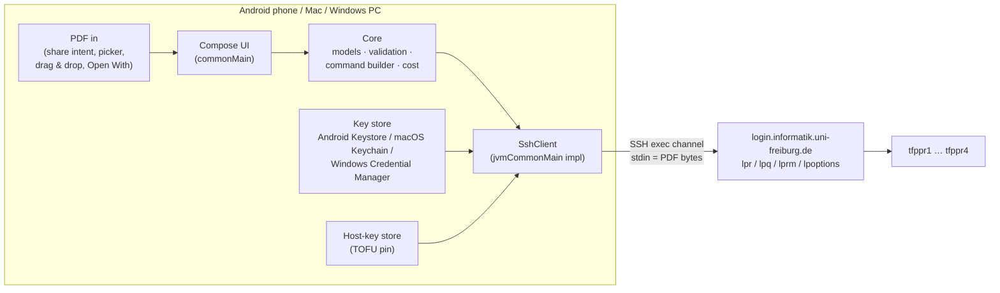

# Architecture

> Status: **M1–M4 implemented**. Update this document whenever the
> implementation diverges.
>
> Where M1 differs from the sketches below: `service` (`PoolServices`, `ErrorCatalogue`) and `ui`
> (`OnboardingModel`, `PrintModel`, `SettingsModel` plus the screens) exist as extra packages; the key
> store, host-key store and settings are DataStore-backed in `commonMain`; `buildAppDependencies`
> (`jvmCommonMain`) wires the real implementations for both platforms; `rememberPdfPicker` and
> `rememberTextSharer` are `expect`/`actual` composables. M3 adds `DiscoveryService`, `QueueService`
> and `PresetManager` to `AppDependencies`, `PoolServices.run` for non-`lpr` commands, and the Queue and
> Presets screens (`QueueModel`, `PresetsModel`).

## Big picture



No component talks to anything other than the pool login server.

## Gradle modules

| Module | Role | Rules |
|---|---|---|
| `:shared` | KMP library holding **all** app logic and UI | Features go here |
| `:androidApp` | Android application shell (manifest, `MainActivity`, intent handling glue) | Keep thin |
| `:desktopApp` | Compose Desktop shell (`main.kt`, window, macOS packaging) | Keep thin |
| `buildSrc` | Build logic only: `PoolPrintVersion` reads the app version from `gradle.properties` for both app modules | No app code |

## Source sets in `:shared`

```
commonMain            pure Kotlin + Compose: models, validation, command builder, parsers,
                      cost estimator, interfaces (SshClient, KeyStore, …), view models, UI
   └── jvmCommonMain  NEW intermediate source set shared by Android and desktop JVM:
         │            real SshClient (SSH library), Ed25519 key generation, PDF byte streaming
         ├── androidMain   Android Keystore encryption, PdfRenderer page count, content-URI reading
         └── jvmMain       macOS Keychain / Windows Credential Manager / ~/.ssh key import, PDFBox page count, file reading
commonTest            unit tests for everything in commonMain + FakeSshClient
jvmCommonTest         (optional) tests for the real SshClient against an in-process SSH server
jvmTest / androidHostTest   platform-specific tests
```

`jvmCommonMain` has to be wired up explicitly. The default hierarchy template has no
"Android + JVM" group, so `shared/build.gradle.kts` adds one with `applyDefaultHierarchyTemplate { common {
group("jvmCommon") { withJvm(); withCompilations { it.platformType == KotlinPlatformType.androidJvm } } } }`.
(`withAndroidTarget()` doesn't match the new `com.android.kotlin.multiplatform.library` target, and manual
`dependsOn` edges switch the default template off with a warning.)

**Rule:** `commonMain` must not reference `java.*`, `android.*` or any SSH/PDF library. If something
needs the platform, define an interface in `commonMain` and implement it lower down.

## Package layout

Root package: `com.yahyafati.poolprint`.

| Package | Source set | Contents |
|---|---|---|
| `core.model` | common | `Printer`, `PrinterType` (BW/COLOR), `PrintOptions`, `PrintJob`, `Duplex`, `PagesPerSheet`, `Orientation`, `PaperSize`, `PageRanges` |
| `core.validation` | common | Validators that turn raw UI input into typed values or a `ValidationError` |
| `core.command` | common | `ShellQuote`, `RemoteCommand`, `LprCommandBuilder`, `LpstatCommandBuilder`, `LpoptionsCommandBuilder`, `LpqCommandBuilder`, `LprmCommandBuilder` |
| `core.cost` | common | `CostEstimator`, `CostEstimate` (integer cents) |
| `core.discovery` | common | `LpstatParser`, `LpoptionsParser`, `DiscoveredPrinter`, `PrinterCapabilities`, `DiscoveredOption`, `DiscoverySnapshot`, `DiscoveryPolicy` |
| `core.queue` | common | `LpqParser`, `QueueEntry`, `QueueSnapshot`, `OwnedJobId` |
| `transport` | common (interface), jvmCommon (impl) | `SshClient`, `SshResult`, `SshError`, `ConnectionConfig`, `ByteSource` |
| `keys` | common (interface), platform (impl) | `KeyManager`, `PrivateKeyStore`, `PublicKeyFormatter` |
| `hostkeys` | common (interface), platform (impl) | `HostKeyStore`, `HostKeyVerdict` |
| `pdf` | common (interface), platform (impl) | `PdfDocumentSource`, `PdfPageCounter` |
| `settings` | common (interface), platform (impl) | Last-used options (`StoredPrintOptions`), `Preset` / `PresetManager` / `PresetStore`, `DiscoveryStore`, username |
| `service` | common | `PoolServices` (test, print, `run`), `DiscoveryService`, `QueueService`, `ErrorCatalogue` |
| `ui.*` | common | Screens, view models, theme |

## Key interfaces (sketch)

These are design intent, not final signatures.

```kotlin
// commonMain — streaming without java.io
interface ByteSource : AutoCloseable {
    /** Reads up to buffer.size bytes; returns -1 at end. */
    fun read(buffer: ByteArray): Int
}

/** A command that is already validated and quoted. Only the core.command builders can create one. */
class RemoteCommand internal constructor(val value: String)

interface SshClient {
    suspend fun exec(
        command: RemoteCommand,
        stdin: ByteSource? = null,
        onUploaded: (Long) -> Unit = {},          // bytes sent so far, for the progress bar
        timeoutMs: Long = DEFAULT_TIMEOUT_MS,
    ): SshResult

    // One-time onboarding key install (D-20): password auth, runs only AuthorizeKeyCommand, zeroes the password.
    suspend fun installKeyWithPassword(password: CharArray, key: PublicKeyLine): SshResult
}

data class SshResult(val exitCode: Int, val stdout: String, val stderr: String)

sealed interface SshError {
    data object HostUnreachable : SshError         // DNS, no route, timeout on connect
    data object AuthRejected : SshError            // key not in authorized_keys (or wrong password for the install)
    data class HostKeyUnknown(val keyType: String, val fingerprint: String) : SshError   // first connect: ask user
    data class HostKeyChanged(val expected: String, val actual: String) : SshError  // loud warning
    data object Timeout : SshError
    data class Protocol(val message: String) : SshError
}
```

- `exec` returns `SshResult` even when the exit code isn't 0. A non-zero exit is a remote failure that
  gets shown to the user with stderr, not a transport error.
- Transport failures are thrown as `SshException(SshError)` (D-10). `PoolServices` catches them once and
  returns typed results with a `UserFailure` for the UI. One `SshClient` is created per operation
  through an `SshClientFactory`.
- `RemoteCommand` has an `internal` constructor, so the UI layer can't build a raw command string by
  accident.
- `FakeSshClient` (in `commonTest`) records commands and stdin bytes and returns scripted results or
  errors. All flow and view-model tests use it.

## Main data flow: printing

1. **Input.** Platform glue turns a share intent, picker result, drop or Open-With event into a
   `PdfDocumentSource`: display name, size, a way to open a `ByteSource`. The page count comes from `PdfPageCounter` (counted on the device, off the UI thread). The display
   name is shown in the UI only. It never reaches the remote command.
2. **Options.** The UI pre-fills from the last-used options or the selected preset. Every change goes
   through `core.validation`.
3. **Estimate.** `CostEstimator.estimate(options, pageCount, policy)` → `CostEstimate`, shown on the Print button.
4. **Build.** `LprCommandBuilder.build(job, capabilities)` → `RemoteCommand`, or a validation error.
5. **Execute.** `SshClient.exec(command, stdin = document.openByteSource())` opens an exec channel and
   streams the bytes into stdin. When the bytes are done it closes stdin (EOF), then waits for the
   exit status.
6. **Report.** Exit 0 means success; CUPS usually prints `request id is tfppr1-123 (1 file(s))` to
   stdout, so parse the job id if it's there. A non-zero exit or an `SshError` gets mapped to a
   user-facing message ([ux.md](ux.md#error-catalogue)), with the raw stderr behind a "Details" toggle.

## Other flows

- **Test connection:** `exec("echo ok")` → expects stdout `ok`, exit 0.
- **Discovery (M3):** `lpstat -p` → printer list; per printer `lpoptions -p <printer> -l` → options.
  Results are cached per printer with a timestamp (24 h staleness, D-16), and can be refreshed manually. If anything fails,
  the app silently falls back to the hardcoded printers and standard options, with a small "Using
  defaults" hint.
- **Queue (M3):** `lpq -P <printer>` → `LpqParser` → entries; the user's own entries get a Cancel action →
  `lprm -P <printer> <jobId>`.

## Platform layer

### Android (`:androidApp` + `androidMain`)

- Manifest intent filter: `ACTION_SEND`, MIME `application/pdf`, so Pool Print shows up in the share
  sheet. (`ACTION_VIEW` for PDFs is a possible later extra.)
- In-app picking: `ACTION_OPEN_DOCUMENT` through the Activity Result API, with MIME `application/pdf`.
- Read content URIs through `ContentResolver`. No storage permission is needed.
- Page count: `android.graphics.pdf.PdfRenderer` (built in). It needs a seekable file descriptor, so
  copy non-seekable streams into app cache first, and delete the copy after printing.
- Private key: encrypted with an AES-GCM key that lives in Android Keystore. See [security.md](security.md).
- Network: `INTERNET` permission only.

### Desktop OS switch (`jvmMain`, W1)

- `DesktopOs` (`jvmMain/desktop`) is detected from `os.name` (`MacOs`, `Windows`; anything else throws
  `UnsupportedOsException`, which `main()` prints before exiting, D-25). Platform facts reach the code as
  parameters, never through `commonMain`: `commonMain` has no OS-specific strings or shortcuts.
- `jvmMain/app/DesktopAppDependencies.kt` picks per OS: data folder (`~/Library/Application Support/Pool Print` /
  `%LOCALAPPDATA%\Pool Print`, D-27), key store (`MacKeychainPrivateKeyStore` / `WindowsCredentialPrivateKeyStore`,
  D-04 / D-26) and the host-name fallback for the key comment (`mac` / `pc`). The selection functions take the OS,
  home folder and environment as arguments, so they are unit-tested on any OS.
- `PoolPrintMenuBar(os, …)` uses ⌘ (meta) on macOS and Ctrl on Windows.

### Desktop file hand-over (`jvmMain/desktop`, W2)

- `main(args)` calls `startDesktop(os, args, incoming)` before any window, DataStore or key store exists. Files named on
  the command line go to `IncomingPdfs.offer` (every OS; macOS gets none, its Open With arrives as an event). On
  **Windows only** (D-28) it also enforces one running instance:
  - `SingleInstance.tryAcquire(dataDir)` takes an exclusive `FileChannel` lock on `instance.lock` (`DesktopStartup.kt`).
    The first instance then runs `HandOverListener` (`HandOver.kt`): a loopback-only `ServerSocket`, one bounded
    connection at a time, and publishes port + token in `instance.handover` (`HandOverEndpoint`).
  - A later instance gets no lock, so `HandOverClient` sends its first PDF path with the token (retrying for up to 5 s
    while the first one starts) and `main` exits with `StartupResult.Exit` — it never reaches `application { … }`,
    so nothing opens the DataStore, the Credential Manager or the network.
  - The listener hands accepted paths to `IncomingPdfs`, so they take the same route as a drop. `main.kt` brings the
    window to the front when a document arrives. Protocol and limits: [security.md](security.md#single-instance-and-file-hand-over-windows).
  - macOS stays without this: LaunchServices already runs one process per app (D-28 scope).
- Windows has no `setOpenFileHandler`; `installOpenFileHandler()` returns false there and the command line plus the
  hand-over replace it.
- Drag and drop needs no change for Explorer: it offers `DataFlavor.javaFileListFlavor` like Finder, which `filesIn`
  reads (🔶 checked by hand on Windows).

### macOS desktop (`:desktopApp` + `jvmMain`)

- File picker: AWT `FileDialog`, the native open panel on macOS (and on Windows). `FilenameFilter` is honoured on macOS
  only; on Windows `dialog.file = "*.pdf"` is what filters the dialog (`pickerFilePattern`). The result is re-checked
  with `isPdfFile` on both (`pickedPdf`), because a filter is only a hint.
- Drag and drop onto the window: `PdfDropTarget` (Compose `dragAndDropTarget`, reads the AWT file list).
  It shows a hint while a file hovers and a short message when the drop holds no PDF.
- "Open With": `java.awt.Desktop.setOpenFileHandler` and `CFBundleDocumentTypes` for `com.adobe.pdf`
  (rank `Alternate`, so Preview stays the default) in the app's `Info.plist`, through
  `compose.desktop.application.nativeDistributions.macOS.infoPlist`. `main()` installs the handler before
  the window exists (macOS queues earlier open-file events until then).
- `IncomingPdfs` (`jvmMain/desktop`) is the one inbox for dropped files, Open With, the command line, hand-overs and ⌘O / Ctrl+O. It keeps the
  latest PDF (first PDF of several files) as a `StateFlow`; `main.kt` passes it to `App(incomingDocument = …)`.
  `App` drops a document that arrives while a job is uploading or waiting for host-key trust.
- Menu bar: `PoolPrintMenuBar` (File → Open PDF… ⌘O / Ctrl+O, Print ⌘P / Ctrl+P). ⌘P goes through `AppCommands`
  (`commonMain/app`): the print sheet registers its `print` action while `canPrint` is true, the menu item
  is enabled exactly then.
- Page count: Apache PDFBox (the allowed "PDF page-count library").
- Private key: macOS Keychain through JNA and the Security framework, or a user-chosen existing key
  from `~/.ssh` (with its passphrase, if any, kept in the Keychain). See
  [decisions.md](decisions.md#d-04-macos-keychain-access).
- Packaging: `.dmg` through `packageDmg` (M4, D-18). Code signing and notarisation are out of scope unless requested.

## State and persistence

| Data | Where | Notes |
|---|---|---|
| Pool username | settings | Not secret |
| Private key | platform secure store | Never logged, never exported in plaintext |
| Public key | settings (or derived) | Shown during onboarding and in Settings |
| Pinned host key | host-key store | SHA-256 fingerprint plus key type, per `host:port` |
| Last-used printer and options | settings | M2 |
| Presets | settings | M3 |
| Discovery cache | settings/cache | Per printer, with timestamp, M3 |

Non-secret state is stored with AndroidX DataStore plus `kotlinx-serialization-json`
([decisions.md](decisions.md#d-03-persistence-for-settings-presets-and-caches)). Secrets go only in
the platform secure store.

## Concurrency

- All SSH calls are `suspend` and run on `Dispatchers.IO` inside the implementation.
- One SSH connection per operation is fine for M1. Connection reuse is an optimisation for later.
- Printing can be cancelled while bytes are uploading (closing the channel); after `lpr` has accepted
  the job, cancelling means `lprm`.
